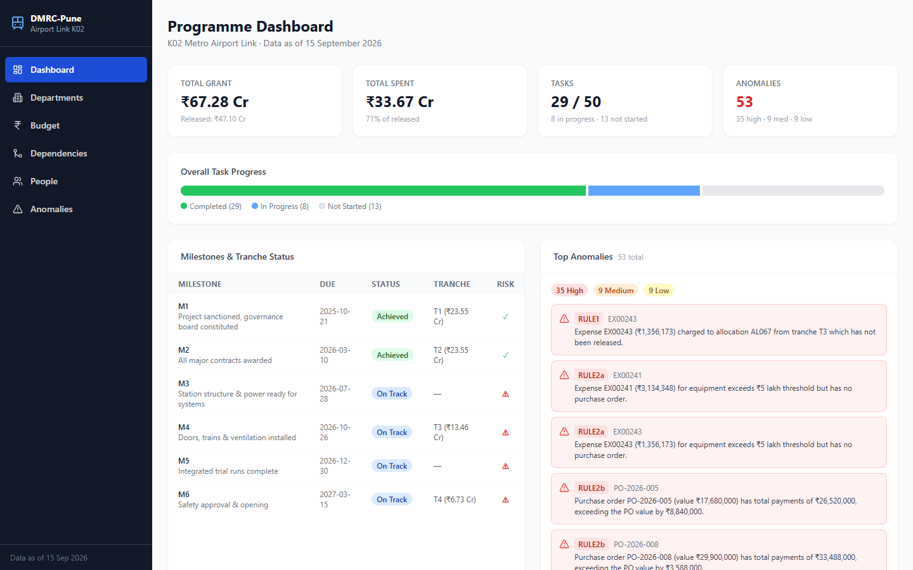
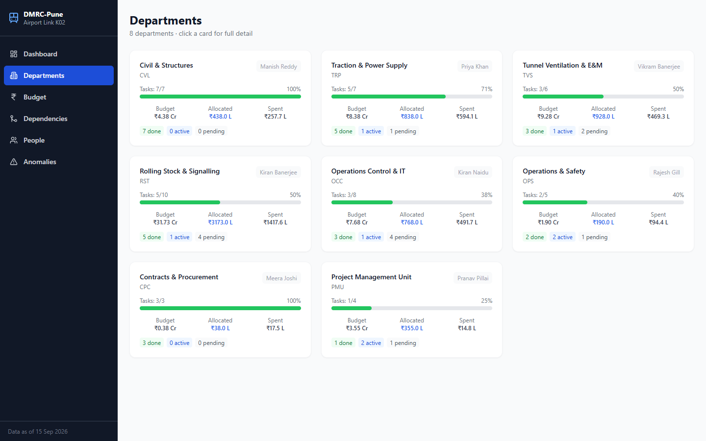
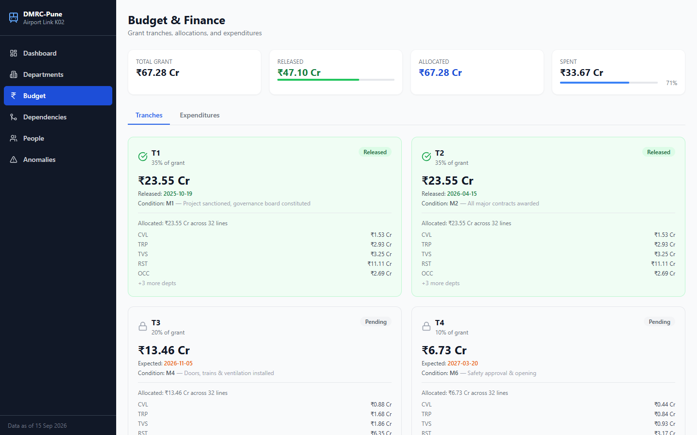
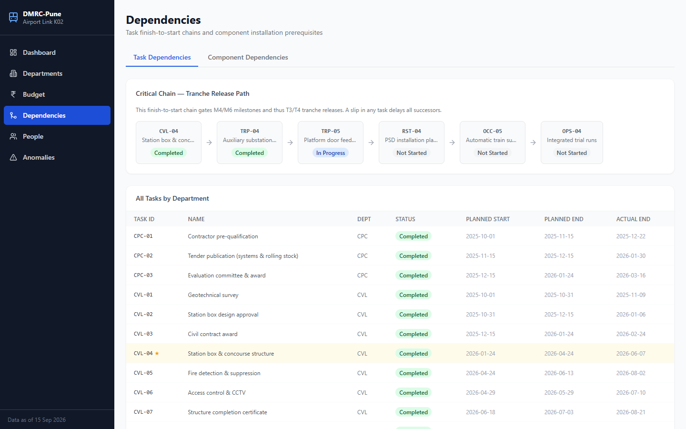
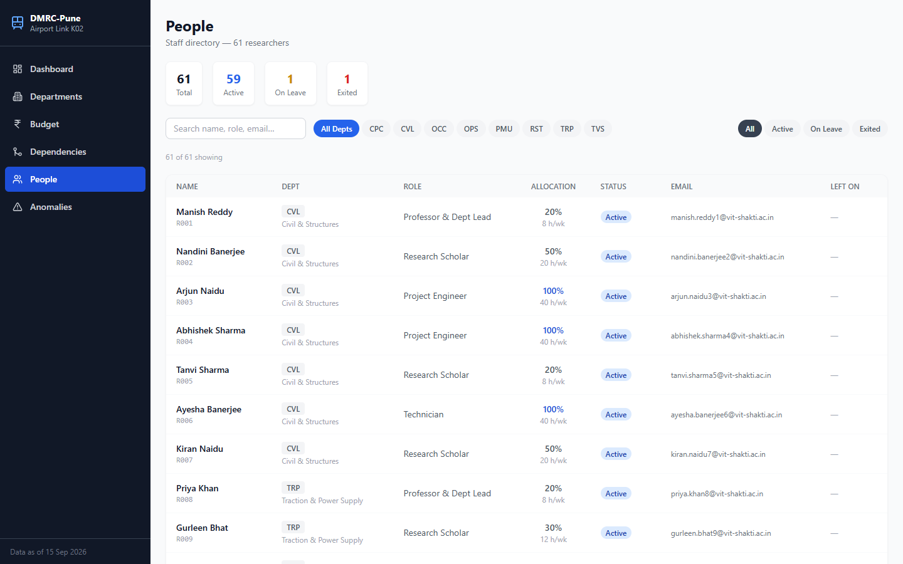
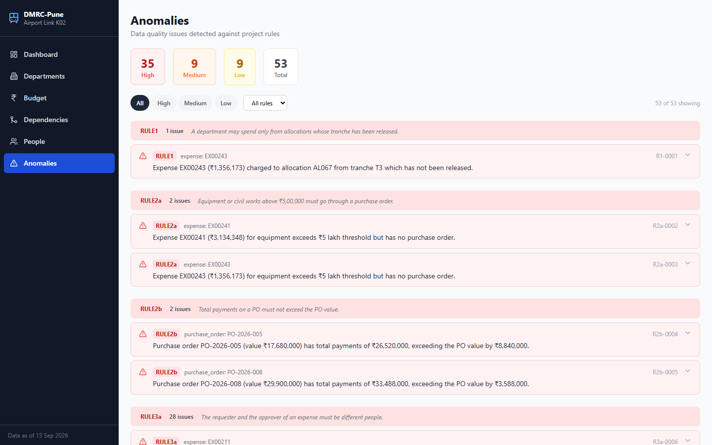

# K02 Metro Airport Link — Programme Dashboard

A full-stack web application for monitoring the DMRC-Pune Airport Link station and rolling stock programme.

## Quick Start

```bash
docker compose up --build
```

Then open **http://localhost:3000**

The backend API is available at **http://localhost:8000** (OpenAPI docs at http://localhost:8000/docs).

## Running Tests

```bash
cd backend
pip install -r requirements.txt
pytest -v
```

## Wireframe

See [`wireframe.md`](wireframe.md) — ASCII wireframes for all 6 pages, sketched before coding, with information-design rationale.

## App Tour

### 1. Dashboard


The first screen answers the Project Director's question in under a minute:
- **KPI strip**: Total grant (₹67.28 Cr) · Released (₹47.10 Cr) · Total Spent (₹33.67 Cr) · Anomaly count (53)
- **Task progress bar**: 29 completed / 8 in progress / 13 not started out of 50 tasks
- **Milestone table**: All 6 milestones with tranche amounts and ⚠ at-risk flags — M3, M4, M5, M6 are flagged because their linked tasks are not yet complete
- **Top anomalies**: The most critical data issues visible at a glance
- **Department budget chart**: Budget vs allocated vs spent per department

### 2. Departments


- **Grid view**: 8 department cards each showing task completion %, budget, allocated, spent, and head name
- CVL is 100% done · RST is 50% (4 tasks not started) · PMU is 25% — immediately visible
- **Click any card** → full detail view with task list and people roster

### 3. Budget


Two tabs:
- **Tranches**: T1 and T2 released (₹23.55 Cr each, green), T3 (₹13.46 Cr) and T4 (₹6.73 Cr) pending with expected release dates and condition milestones
- **Expenditures**: Sortable table of all expense records; self-approval rows highlighted in red

### 4. Dependencies


- **Critical chain** shown at top: CVL-04 → TRP-04 → TRP-05 → RST-04 → OCC-05 → OPS-04 — TRP-05 is still In Progress, and RST-04/OCC-05/OPS-04 are Not Started, putting M4/T3 at risk
- **Full task table** below with critical-chain tasks highlighted (★)
- **Component Dependencies** tab: 315 components with status browser

### 5. People


- 61 total researchers: 59 active · 1 on leave · 1 exited
- Filter by department (CVL, TRP, TVS, RST, OCC, OPS, CPC, PMU) or status
- Shows allocation % and equivalent hours/week (e.g. 20% = 8 h/wk)

### 6. Anomalies


53 total issues detected — 35 high · 9 medium · 9 low — grouped by rule with plain-language descriptions:
- **RULE1**: 1 expense against unreleased tranche T3
- **RULE2a**: 2 equipment expenses >₹5L with no PO
- **RULE2b**: 2 POs where total payments exceed PO value
- **RULE3a**: 28 self-approval cases (same requester and approver)
- Each anomaly is expandable for full detail. Filter by severity or rule.

## Architecture

```
docker-compose.yml
├── backend/         FastAPI + pandas (Python 3.12)
│   ├── app/
│   │   ├── main.py          entrypoint, CORS, router mounting
│   │   ├── data_loader.py   DataStore: reads all 13 CSVs, normalises
│   │   ├── models.py        Pydantic response models
│   │   ├── anomaly_detector.py  12 rule checks
│   │   └── routers/         dashboard, departments, budget, tasks,
│   │                        components, people, anomalies
│   └── tests/               pytest (anomalies + budget)
└── frontend/        React 18 + TypeScript + Vite + Tailwind
    └── src/
        ├── pages/   Dashboard, DepartmentDetail, Budget,
        │            Dependencies, People, Anomalies
        └── components/  Layout, StatusBadge, ProgressBar, AnomalyPanel
```

Data files are mounted read-only into the backend container at `/data`.
